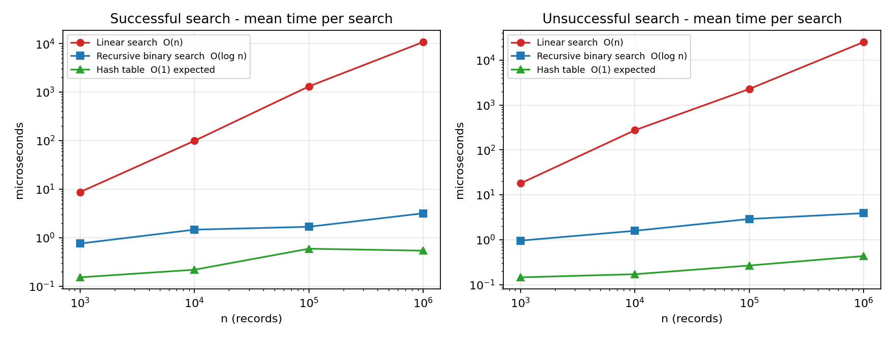
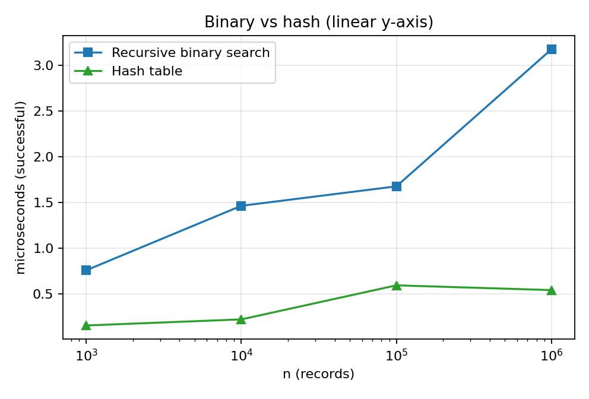
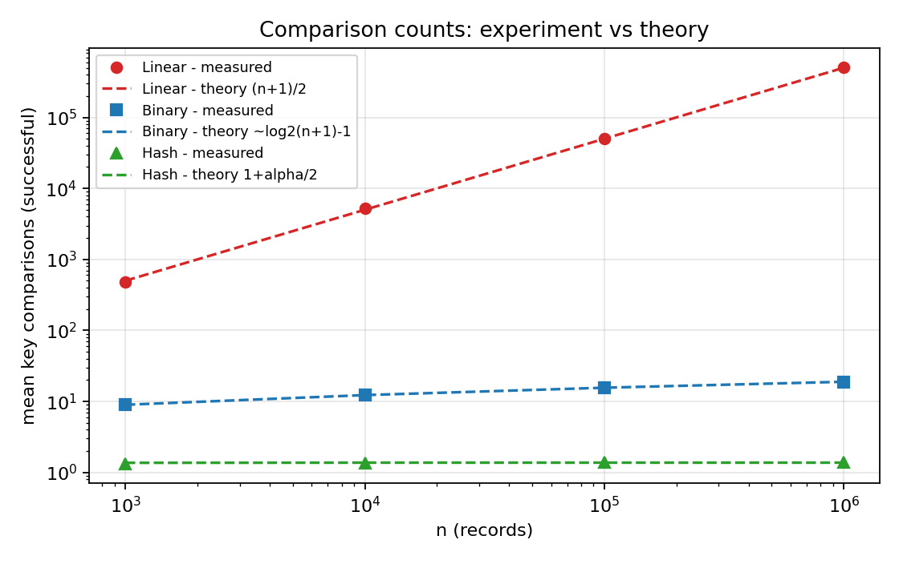
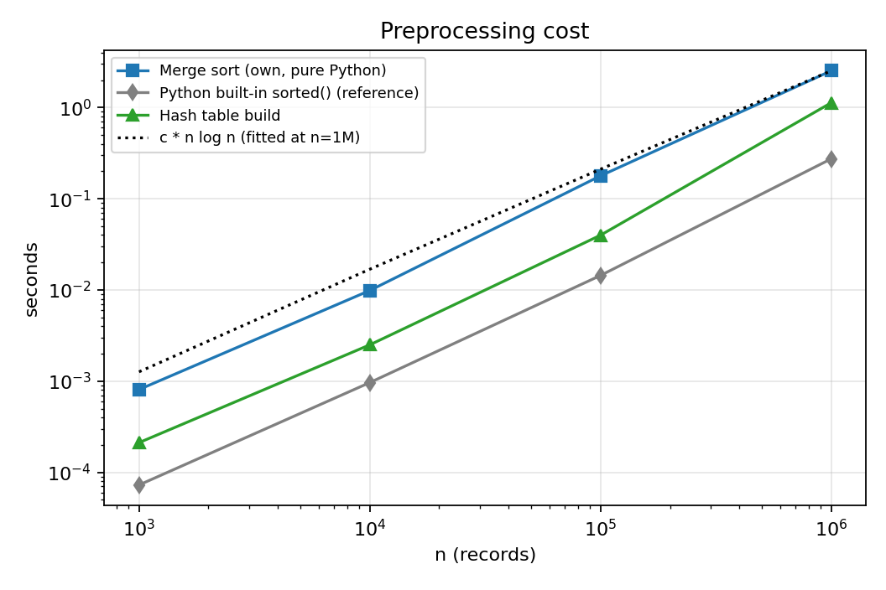
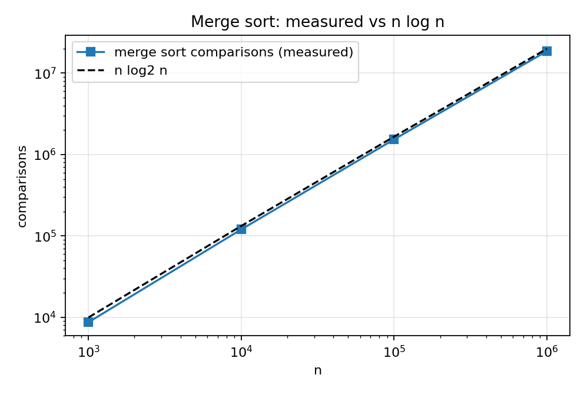
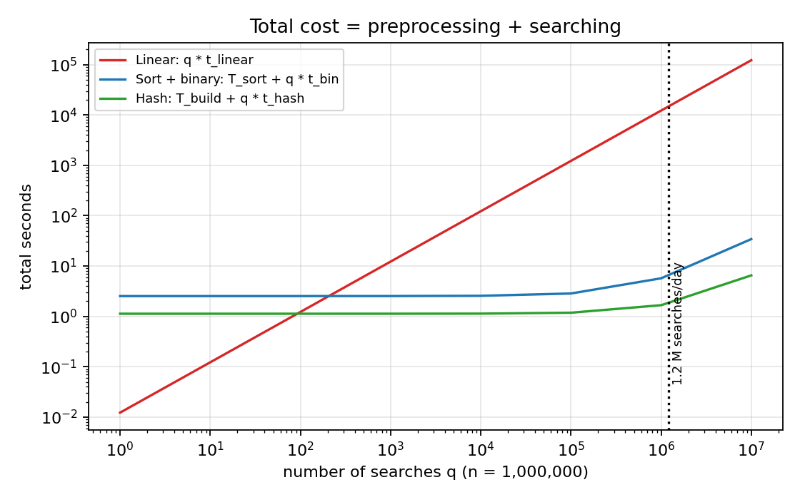
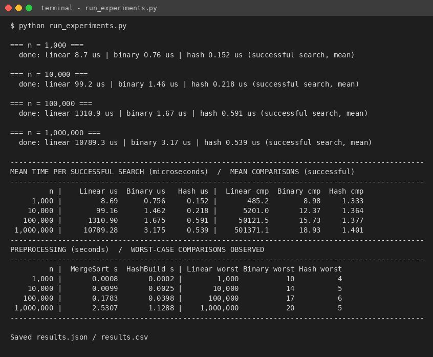

# Experimental analysis and design decisions (Tasks 9-12)

## Task 9 - Experimental Performance

All values below come from run_experiments.py (raw data: results.csv / results.json in Task_9_Experimental_Performance). Measured on one machine, so absolute values will differ on another computer; the **growth behaviour** is what matters.

**Table 9.1 - Mean time per search (microseconds)**

| n | A Linear hit | B Binary hit | C Hash hit | A Linear miss | B Binary miss | C Hash miss |
|---|---|---|---|---|---|---|
| 1,000 | 8.692 | 0.756 | 0.152 | 18.02 | 0.956 | 0.146 |
| 10,000 | 99.16 | 1.462 | 0.218 | 274.80 | 1.583 | 0.171 |
| 100,000 | 1,310.90 | 1.675 | 0.591 | 2,276.68 | 2.898 | 0.267 |
| 1,000,000 | 10,789.28 | 3.175 | 0.539 | 25,355.30 | 3.910 | 0.434 |

**Table 9.2 - Key comparisons (basic operations)**

| n | A avg (hit) | A worst | B avg (hit) | B worst | C avg (hit) | C avg (miss) | C max chain |
|---|---|---|---|---|---|---|---|
| 1,000 | 485 | 1,000 | 8.98 | 10 | 1.333 | 0.729 | 4 |
| 10,000 | 5,201 | 10,000 | 12.37 | 14 | 1.364 | 0.751 | 5 |
| 100,000 | 50,121 | 100,000 | 15.73 | 17 | 1.377 | 0.712 | 6 |
| 1,000,000 | 501,371 | 1,000,000 | 18.93 | 20 | 1.401 | 0.777 | 5 |

**Table 9.3 - Preprocessing time and extra memory**

| n | Merge sort comparisons | Merge sort s | Built-in sorted() s | Hash build s | Sorted copy MB | Hash index MB |
|---|---|---|---|---|---|---|
| 1,000 | 8,712 | 0.0008 | 0.0001 | 0.0002 | 0.01 | 0.09 |
| 10,000 | 120,390 | 0.0099 | 0.0010 | 0.0025 | 0.08 | 0.96 |
| 100,000 | 1,536,237 | 0.1783 | 0.0144 | 0.0398 | 0.80 | 9.65 |
| 1,000,000 | 18,674,355 | 2.5307 | 0.2741 | 1.1288 | 8.00 | 96.64 |

**Table 9.4 - Break-even number of searches in measured time (successful-search timings)**

| n | Searches q so that sort pays for itself (B vs A) | Searches q so that hash build pays for itself (C vs A) |
|---|---|---|
| 1,000 | 102 | 25 |
| 10,000 | 101 | 25 |
| 100,000 | 136 | 30 |
| 1,000,000 | 235 | 105 |

*Figure 9.1 - Search time vs n (log-log). Linear slope ~1; binary and hash almost flat.*

*Figure 9.2 - Binary search vs hash table on a linear y-axis*

*Figure 9.3 - Measured comparison counts against the theoretical formulas*

*Figure 9.4 - Preprocessing time vs n*

*Figure 9.5 - Merge sort comparisons vs n log2 n*

*Figure 9.6 - Total cost (preprocessing + q searches) at n = 1,000,000*

*Figure 9.7 - Console output of run_experiments.py*

## Task 10 - Theory vs Experiment

## Operation counts agree almost exactly with theory

**Table 10.1 - Theoretical vs observed counts**

| Quantity (n = 1,000,000) | Theory | Measured | Agreement |
|---|---|---|---|
| Linear, successful average comparisons | (n+1)/2 = 500,000.5 | 501,371 | 0.27% difference (sampling error of 1,000 random keys) |
| Linear, worst case | n = 1,000,000 | 1,000,000 | exact |
| Binary, worst case | floor(log2 n)+1 = 20 | 20 | exact |
| Binary, successful average | 18.93 | 18.93 | within sampling error |
| Hash, successful average | 1 + alpha/2 = 1.375 (alpha = 0.750) | 1.401 | close; difference is sampling error of 2,000 keys |
| Hash, unsuccessful average | alpha = 0.750 | 0.777 | close |
| Merge sort comparisons | n log2 n - n + 1 = 18.93 x 10^6 (worst); random-data average ~18.67 x 10^6 | 18,674,355 | between best and worst; matches random-data average |

## Running time: the growth rates agree, constants and memory effects explain the deviations

**Table 10.2 - Growth over a 1,000-fold increase in n**

| Algorithm | Theoretical growth of time, n: 1K to 1M | Observed growth of time (successful) | Per-operation cost at 1K vs 1M |
|---|---|---|---|
| A  Linear | 1,000 x | 1,241 x | 17.9 ns vs 21.5 ns per comparison |
| B  Binary | log2(1M)/log2(1K) = 2.0 x | 4.2 x | 84 ns vs 168 ns per level |
| C  Hash | 1 x | 3.5 x | 1.3 vs 1.4 comparisons |

*Figure 10.1 - Theoretical vs observed growth factor of search time*

- **Linear search** follows the prediction best: its time rises by about 10x for every 10x increase in n (slope 1 on the log-log plot) and the observed 1000-fold growth is about 1.2x larger than predicted. The remaining excess is a memory effect: at n = 1,000 the whole list fits in cache, while at n = 1,000,000 the pointers and the integer objects they refer to occupy tens of megabytes. The loop is also faster per element at the smallest sizes because fixed start-up cost is amortised over fewer elements.
- **Binary search** grows much more slowly than linear search and is logarithmic in the *number of comparisons* (8.98, 12.37, 15.73, 18.93), which agrees with theory, but its *time* grows 4.2x rather than 2x. The cost per level rose from about 84 ns to 168 ns: with a sorted array of 1M elements the first probes hit different memory pages and miss the CPU cache, whereas a 1,000-element array is entirely cache resident. Recursion overhead in Python is a constant per level and cannot cause growth. So the asymptotic model (every comparison costs the same) is violated by the memory hierarchy, not by the algorithm.
- **Hash table.** The comparison count is constant (1.33 to 1.40), exactly as predicted, yet the time grew 3.5x. Here too, the lookup touches three or four distinct memory locations (bucket slot, chain list, record, key object) which are cache-resident for small n but not for n = 10^6. The differences between consecutive sizes (e.g. 0.59 us at n = 100,000 vs 0.54 us at n = 1,000,000) are within run-to-run variation of a few tenths of a microsecond; for such short operations the timer resolution and garbage-collector/OS noise are of the same order as the effect.
- **Preprocessing.** Merge sort time grew by 12x, 18x and 14x for successive 10x increases of n (n log n predicts about 12x); the hash build grew by 12x, 16x and 28x (theory: 10x). The extra growth in the hash build is memory allocation: creating about 700,000 Python list objects for the chains at n = 10^6 is slower per record than the few hundred lists at n = 10^3, and the larger working set causes cache misses.

## Which algorithm scales best?

Scalability ordering in both theory and experiment is **C (hash) > B (binary) > A (linear)**. At n = 1,000,000 a successful hash search took about 0.5 us, binary search about 3 us and linear search about 10,800 us (10.8 ms) - the linear search was about 3,400 times slower than binary search and about 20,000 times slower than the hash lookup.

## Reasons for remaining differences between theory and experiment

- **Constant factors and the interpreter.** Big-O ignores constants; in Python one loop iteration costs about 20 ns, one recursive call about 80-170 ns, one hash lookup about 0.3-0.6 us. A compiled language would change the constants but not the growth rates.
- **Memory hierarchy (cache / TLB misses)** as explained above - the RAM-model assumption of uniform access cost does not hold.
- **Sampling and measurement noise.** Averages over 100-2,000 random keys have statistical error (1,000 sampled linear searches carry a 0.3% error); sub-microsecond timings include loop and timer overhead; the experiment ran on a shared machine.
- **Assumption of uniform hashing.** The theoretical alpha-based figures assume ideal hashing; the measured values are slightly higher, as is expected for a real hash function.
- **Operation weighting.** The unsuccessful linear search took between 1.7x and 2.8x as long as the successful one (2.35x at n = 1M) against the 2x predicted from n vs (n+1)/2; the spread comes from the small number of timed queries and from the sampling of where the successful keys happen to lie.

## Task 11 - Final Design Recommendation

**Recommendation for the original (general-purpose) problem: keep the registration numbers in a sorted array and use binary search; sort once with merge sort (or the system sort) and re-merge new records in batches.** The hash table is the strongest alternative and is adopted in Task 12 once the workload is known.

## Why this choice - evidence from analysis and experiment

**Table 11.1 - Criteria-based comparison**

| Criterion | A  Linear | B  Sort + binary | C  Hash |
|---|---|---|---|
| Search cost, theory | Theta(n) | Theta(log n), worst case guaranteed | Theta(1) expected, Theta(n) worst |
| Measured search at n = 1M (hit / miss) | 10,789 / 25,355 us | 3.17 / 3.91 us | 0.54 / 0.43 us |
| Preprocessing (theory) | none | Theta(n log n) | Theta(n) |
| Preprocessing measured, n = 1M | 0 | 2.53 s (own merge sort); 0.27 s with built-in sort | 1.13 s |
| Preprocessing paid back after (searches) | - | ~235 searches | ~105 searches |
| Extra memory at n = 1M | 0 | 8 MB (one pointer per record) | 97 MB (about 12x more) |
| Supports ordered / range / prefix queries (e.g. all students of one batch) | no (full scan) | yes - contiguous range | no |
| Depends on hash quality / worst-case guarantee | n/a | no - deterministic | yes |
| Practical as n grows | No - cost grows with n | Yes - 20 -> 24 comparisons for 1M -> 10M | Yes - if table is resized with n |

- **Why not linear search?** At 1,000,000 records one lookup takes 10.8 ms on average and 25.4 ms when the number is not present. Its only advantage - no preprocessing - disappears after roughly 100-200 searches (Table 9.4), a tiny number for a university system.
- **Why binary search rather than the (faster) hash table in the *general* case?** (i) Guaranteed worst case of 20 comparisons for 10^6 records, whatever the key pattern; (ii) 12 times less extra memory (8 MB vs 97 MB); (iii) a sorted array answers range/prefix questions that administrators actually ask (all registration numbers of one admission year); (iv) it is about 6x slower than the hash table in the single-key benchmark (2.5x in the mixed 50,000-request run of Task 12) - a difference of only a few microseconds per search; (v) it only needs a comparison order on keys. When nothing is known about update or query frequency, this is the most robust choice.

## Trade-offs and limitations

- **Preprocessing cost.** Sorting 1M records took 2.5 s with the simple merge sort (the pure-Python built-in sort needs 0.27 s). It must be repeated or repaired when records are added: inserting into the middle of a sorted array costs O(n) per record, so new records should be collected and merged in batches (sort the k new keys, then one linear merge - 0.24 s for 2,000 keys at n = 1M, Task 12).
- **Memory/caching.** Binary search touches scattered memory locations; at n = 10^6 each level cost about twice as much as at n = 10^3 (Task 10).
- **Scalability.** Extrapolating the measured n log n behaviour, sorting 10 million records would take about 30 s in this implementation (extrapolation, not measured); a search would need 24 comparisons. Beyond main-memory sizes the same idea generalises to disk-based B-trees, which are the multi-way relatives of binary search.
- **Not recommended** if the data change continuously (every insert needs a re-sort or a tree structure), or if memory is not a concern and only exact-match lookups are needed - the situation analysed in Task 12.

*Figure 11.1 - Total cost of each design as the number of searches grows (n = 1M)*

## Task 12 - Day-4 Design Challenge

**Changed requirement:** 50,000 search requests per hour = 13.9 requests per second = 1,200,000 per day on a database of 1,000,000 records, with new records added **once per day**. **Decision: MODIFY** - the sorted-array design is kept as the ordered master copy, but exact-match lookups are redesigned to use a hash index that is rebuilt/extended in a nightly batch.

## A. Impact analysis (2 marks)

- **What changed.** The original problem gave no information about how many searches there would be; q was an unknown symbol. Now q is known: about 1,200,000 searches per day, i.e. about **1.2 searches per record per day**, and the data are static for 24 hours at a time.
- **Assumptions affected.** (1) 'Preprocessing cost must be weighed against a handful of searches' - no longer true: the nightly preprocessing (2.6 s sort or 1.5 s hash build) is shared by 1.2 million searches, i.e. 2.2 us or 1.2 us per search. (2) 'The database may change at any time and the structure must handle frequent updates' - no longer true; updates are a daily batch.
- **Why search frequency matters now.** Total cost = preprocessing + q x (cost per search). With q = 1.2 million/day the per-search term dominates everything. At the linear-search speed of 14.9 ms the daily search work would be about 5.0 CPU-hours, versus 5.1 s (binary) or 2.3 s (hash). A change in the constant or order of the per-search cost is multiplied by 1.2 million.
- **Why infrequent updates matter.** Between updates the data never change, so an index can be built once and used read-only: no locking, no resizing in the hot path, the expensive build is amortised over a whole day, and a perfect-fit table (load factor 0.75) can be sized for tomorrow's n. Structures that are fast to search but slow to update (sorted array, static hash) are exactly the right trade-off.

## B. Evaluation of the original design (2 marks)

One simulated hour (50,000 searches, 90% successful) on 1,000,000 records was run (design_challenge.py):

**Table 12.1 - One hour of traffic (n = 1,000,000)**

| Design | Mean latency | p50 | p99 | Max seen | CPU for 50,000 searches | Share of one core | Capacity per core (req/s) |
|---|---|---|---|---|---|---|---|
| A  Linear (measured on 300, extrapolated) | 14.9 ms | 15.6 ms | 32.9 ms | 33.5 ms | 747 s | 20.8% | 67 |
| B  Binary search (measured, 50,000) | 4.08 us | 3.80 us | 9.48 us | 438 us | 0.21 s | 0.0059% | 245,062 |
| C  Hash index (measured, 50,000) | 1.60 us | 1.31 us | 3.38 us | 1417 us | 0.10 s | 0.0027% | 624,906 |

*Figure 12.1 - CPU time for one hour of traffic (log scale)*

- **Original recommendation (sorted array + binary search) under 50,000 searches/hour:** entirely adequate - 0.21 s of CPU per hour (about 0.006% of one core), p99 latency 9.5 us. The load is nowhere near a bottleneck.
- **Preprocessing acceptable?** Yes: 2.6 s per day for the full sort, or 0.24 s to merge 2,000 new records into the existing sorted array (sort the k new keys, then one O(n + k) merge) - negligible next to a 24-hour day (Table 12.2).
- **Could another approach be better?** Linear search is technically feasible on one core (21% utilisation, 15 ms mean and up to 33-42 ms latency), but it burns 5.0 CPU-hours a day, has only 4.8x head-room over the average load (a 10x peak, 139 req/s, would need more than two cores), and degrades linearly as the university grows - rejected. The hash index is the better of the two fast designs: 2.5x lower mean latency, 2.8x lower p99, a build that is 1.8x cheaper than the sort, and O(1) insertion.

## C. Adaptation / redesign (2 marks)

**Decision: MODIFY.** The workload is read-dominated and the updates are batched and rare, which favours a precomputed, read-only index with the fastest possible lookup.

- **Revised strategy.** (1) Keep the sorted array of registration numbers as the *ordered master copy* (range/prefix queries, audit, fallback). (2) Build a hash index (separate chaining, load factor 0.75, multiplicative hash) over the master copy. (3) All exact-match searches (the 50,000/hour) go to the hash index. (4) Once per day a batch job (a) sorts the k new records (O(k log k)) and merges them with the master array (O(n + k)); (b) inserts the k new keys into the hash index (O(k) expected) or rebuilds it in O(n); (c) swaps the new snapshot in atomically, so concurrent readers never need locks.
- **What changed relative to the original design.** The search path changed from O(log n) comparison-based to O(1) expected; the per-day update path changed from 're-sort everything' (O(n log n)) to 'merge a small batch' (O(n + k)) plus incremental hash insertion (O(k)); memory increases from about 8 MB to about 105 MB (an acceptable price for a server).

**Table 12.2a - Effect on complexity**

| Quantity | Original (sorted array + binary) | Modified (hash index + sorted master) |
|---|---|---|
| Search time (worst / expected) | Theta(log n) / Theta(log n) | Theta(n) worst, **Theta(1) expected** |
| Daily update, k new records | re-sort O(n log n) or merge O(n + k) | hash insert **O(k)**, master merge O(n + k) |
| Searches per day q = 1.2 x 10^6: total search comparisons | q log2 n = 2.4e+07 | q (1+alpha/2) = 1.7e+06 |
| Space | Theta(n) | Theta(n) (about 13x larger constant) |
| Range / prefix queries | yes | yes (through the master copy) |

**Table 12.2 - Daily update strategies**

| Strategy for adding 2,000 records to 1,000,000 | Time (s) |
|---|---|
| Append + full re-sort (own merge sort) | 2.764 |
| Append + full re-sort (built-in sort) | 0.280 |
| Sort 2,000 new keys, then merge with sorted master  O(n + k) | 0.236 |
| Hash index: incremental insert of the 2,000 keys  O(k) | 0.007 |
| Hash index: full rebuild  O(n) | 1.585 |

*Figure 12.2 - Nightly update cost for 2,000 new records (log scale)*

*Figure 12.3 - Console output of design_challenge.py*

## D. Evidence-based defence (2 marks)

- **Search frequency.** 13.9 requests/s means a budget of 72 ms per request per core. The hash index uses 1.6 us (about 45,000 times below the budget); binary search 4.1 us; linear search 14.9 ms (about one fifth of the budget). One core running hash lookups could theoretically serve about 624,906 requests per second; binary search 245,062; linear search only 67.
- **Preprocessing cost.** The hash build (1.48 s) is paid back after about 121 searches - about 0.01% of one day's traffic - versus about 214 for the sort (2.62 s). Spread over 1.2 million daily searches the build costs about 1.2 us per search.
- **Dataset size and growth.** Search comparisons are 1.4 (hash) vs 19-20 (binary) vs 500,000 (linear) at n = 10^6, and the hash and binary figures barely change if n grows tenfold, whereas linear search would need 10x more time (about 150 ms mean at 10^7 records, extrapolated).
- **Mathematics.** Total daily comparison count: linear n/2 x q = 6 x 10^11; binary n log n + q log n = 2 x 10^7 + 2.4 x 10^7 = 4.4 x 10^7; hash n + 1.4 q = 10^6 + 1.7 x 10^6 = 2.7 x 10^6 (details in Task 3). The hash design performs the fewest basic operations.
- **Trade-offs honestly stated.** Both fast designs use well under 0.01% of a core at the stated load, so the *absolute* gain from hashing over binary search is small (about 2.5 us per search); it is chosen for lower tail latency, cheaper nightly update, and head-room for peaks and growth. Costs: about 13x more memory (97 MB), expected-case (not worst-case) guarantee, no ordering - which is why the sorted master copy is kept. If memory were severely limited, or no other requirement than 50,000 searches/hour existed and simplicity were preferred, **retaining** binary search would be an equally defensible decision; linear search is not.
- **Limitations of the experiment.** Timings are from one machine (single thread, Python), a 90/10 hit/miss mix, uniformly random keys and no network, disk or concurrency effects; linear search was extrapolated from 300 measured queries. The conclusions rest on the order-of-magnitude differences, which are far larger than any of these effects.
