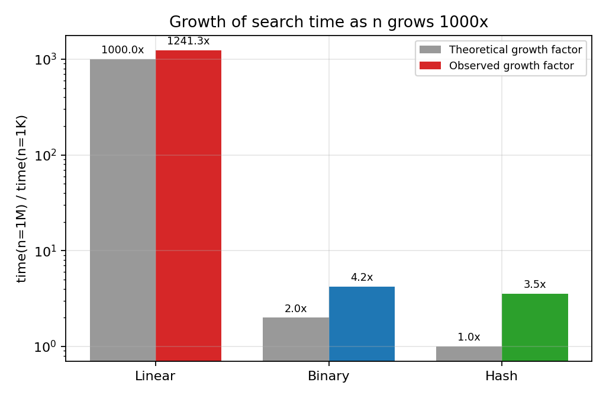

# Task 10 - Theory vs Experiment (4 marks)

## Operation counts agree almost exactly with theory

**Table 10.1 - Theoretical vs observed counts**

| Quantity (n = 1,000,000) | Theory | Measured | Agreement |
|---|---|---|---|
| Linear, successful average comparisons | (n+1)/2 = 500,000.5 | 501,371 | 0.27% difference (sampling error of 1,000 random keys) |
| Linear, worst case | n = 1,000,000 | 1,000,000 | exact |
| Binary, worst case | floor(log2 n)+1 = 20 | 20 | exact |
| Binary, successful average | 18.93 | 18.93 | within sampling error |
| Hash, successful average | 1 + alpha/2 = 1.375 (alpha = 0.750) | 1.401 | close; difference is sampling error of 2,000 keys |
| Hash, unsuccessful average | alpha = 0.750 | 0.777 | close |
| Merge sort comparisons | n log2 n - n + 1 = 18.93 x 10^6 (worst); random-data average ~18.67 x 10^6 | 18,674,355 | between best and worst; matches random-data average |

## Running time: the growth rates agree, constants and memory effects explain the deviations

**Table 10.2 - Growth over a 1,000-fold increase in n**

| Algorithm | Theoretical growth of time, n: 1K to 1M | Observed growth of time (successful) | Per-operation cost at 1K vs 1M |
|---|---|---|---|
| A  Linear | 1,000 x | 1,241 x | 17.9 ns vs 21.5 ns per comparison |
| B  Binary | log2(1M)/log2(1K) = 2.0 x | 4.2 x | 84 ns vs 168 ns per level |
| C  Hash | 1 x | 3.5 x | 1.3 vs 1.4 comparisons |

*Figure 10.1 - Theoretical vs observed growth factor of search time*

- **Linear search** follows the prediction best: its time rises by about 10x for every 10x increase in n (slope 1 on the log-log plot) and the observed 1000-fold growth is about 1.2x larger than predicted. The remaining excess is a memory effect: at n = 1,000 the whole list fits in cache, while at n = 1,000,000 the pointers and the integer objects they refer to occupy tens of megabytes. The loop is also faster per element at the smallest sizes because fixed start-up cost is amortised over fewer elements.
- **Binary search** grows much more slowly than linear search and is logarithmic in the *number of comparisons* (8.98, 12.37, 15.73, 18.93), which agrees with theory, but its *time* grows 4.2x rather than 2x. The cost per level rose from about 84 ns to 168 ns: with a sorted array of 1M elements the first probes hit different memory pages and miss the CPU cache, whereas a 1,000-element array is entirely cache resident. Recursion overhead in Python is a constant per level and cannot cause growth. So the asymptotic model (every comparison costs the same) is violated by the memory hierarchy, not by the algorithm.
- **Hash table.** The comparison count is constant (1.33 to 1.40), exactly as predicted, yet the time grew 3.5x. Here too, the lookup touches three or four distinct memory locations (bucket slot, chain list, record, key object) which are cache-resident for small n but not for n = 10^6. The differences between consecutive sizes (e.g. 0.59 us at n = 100,000 vs 0.54 us at n = 1,000,000) are within run-to-run variation of a few tenths of a microsecond; for such short operations the timer resolution and garbage-collector/OS noise are of the same order as the effect.
- **Preprocessing.** Merge sort time grew by 12x, 18x and 14x for successive 10x increases of n (n log n predicts about 12x); the hash build grew by 12x, 16x and 28x (theory: 10x). The extra growth in the hash build is memory allocation: creating about 700,000 Python list objects for the chains at n = 10^6 is slower per record than the few hundred lists at n = 10^3, and the larger working set causes cache misses.

## Which algorithm scales best?

Scalability ordering in both theory and experiment is **C (hash) > B (binary) > A (linear)**. At n = 1,000,000 a successful hash search took about 0.5 us, binary search about 3 us and linear search about 10,800 us (10.8 ms) - the linear search was about 3,400 times slower than binary search and about 20,000 times slower than the hash lookup.

## Reasons for remaining differences between theory and experiment

- **Constant factors and the interpreter.** Big-O ignores constants; in Python one loop iteration costs about 20 ns, one recursive call about 80-170 ns, one hash lookup about 0.3-0.6 us. A compiled language would change the constants but not the growth rates.
- **Memory hierarchy (cache / TLB misses)** as explained above - the RAM-model assumption of uniform access cost does not hold.
- **Sampling and measurement noise.** Averages over 100-2,000 random keys have statistical error (1,000 sampled linear searches carry a 0.3% error); sub-microsecond timings include loop and timer overhead; the experiment ran on a shared machine.
- **Assumption of uniform hashing.** The theoretical alpha-based figures assume ideal hashing; the measured values are slightly higher, as is expected for a real hash function.
- **Operation weighting.** The unsuccessful linear search took between 1.7x and 2.8x as long as the successful one (2.35x at n = 1M) against the 2x predicted from n vs (n+1)/2; the spread comes from the small number of timed queries and from the sampling of where the successful keys happen to lie.
