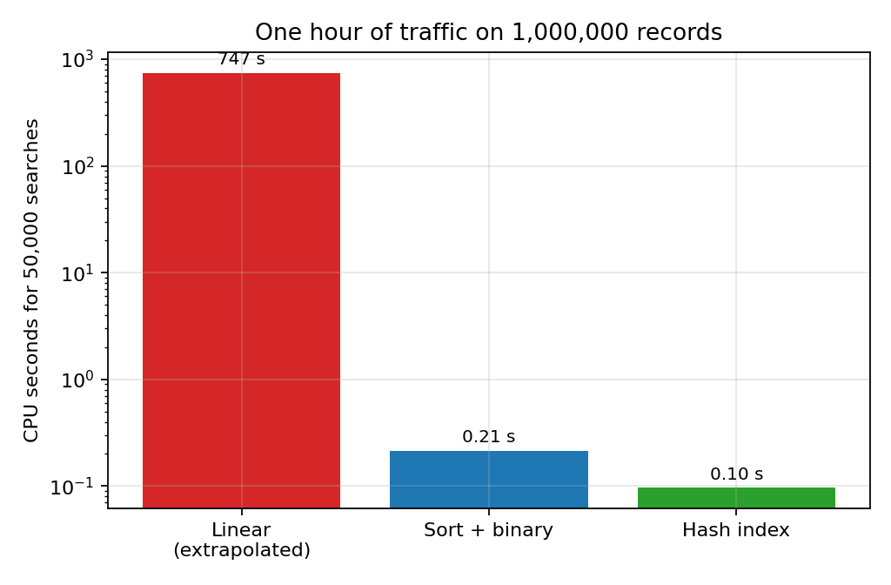
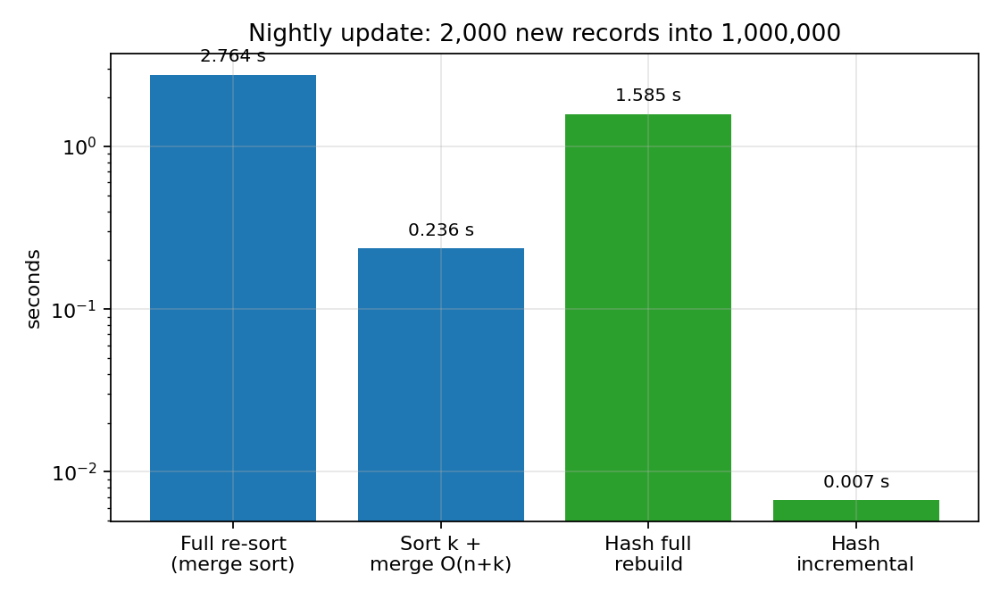
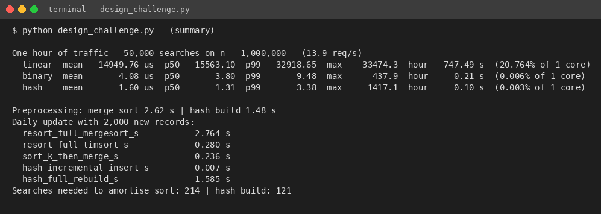

# Task 12 - Day-4 Design Challenge (8 marks)

**Changed requirement:** 50,000 search requests per hour = 13.9 requests per second = 1,200,000 per day on a database of 1,000,000 records, with new records added **once per day**. **Decision: MODIFY** - the sorted-array design is kept as the ordered master copy, but exact-match lookups are redesigned to use a hash index that is rebuilt/extended in a nightly batch.

## A. Impact analysis (2 marks)

- **What changed.** The original problem gave no information about how many searches there would be; q was an unknown symbol. Now q is known: about 1,200,000 searches per day, i.e. about **1.2 searches per record per day**, and the data are static for 24 hours at a time.
- **Assumptions affected.** (1) 'Preprocessing cost must be weighed against a handful of searches' - no longer true: the nightly preprocessing (2.6 s sort or 1.5 s hash build) is shared by 1.2 million searches, i.e. 2.2 us or 1.2 us per search. (2) 'The database may change at any time and the structure must handle frequent updates' - no longer true; updates are a daily batch.
- **Why search frequency matters now.** Total cost = preprocessing + q x (cost per search). With q = 1.2 million/day the per-search term dominates everything. At the linear-search speed of 14.9 ms the daily search work would be about 5.0 CPU-hours, versus 5.1 s (binary) or 2.3 s (hash). A change in the constant or order of the per-search cost is multiplied by 1.2 million.
- **Why infrequent updates matter.** Between updates the data never change, so an index can be built once and used read-only: no locking, no resizing in the hot path, the expensive build is amortised over a whole day, and a perfect-fit table (load factor 0.75) can be sized for tomorrow's n. Structures that are fast to search but slow to update (sorted array, static hash) are exactly the right trade-off.

## B. Evaluation of the original design (2 marks)

One simulated hour (50,000 searches, 90% successful) on 1,000,000 records was run (design_challenge.py):

**Table 12.1 - One hour of traffic (n = 1,000,000)**

| Design | Mean latency | p50 | p99 | Max seen | CPU for 50,000 searches | Share of one core | Capacity per core (req/s) |
|---|---|---|---|---|---|---|---|
| A  Linear (measured on 300, extrapolated) | 14.9 ms | 15.6 ms | 32.9 ms | 33.5 ms | 747 s | 20.8% | 67 |
| B  Binary search (measured, 50,000) | 4.08 us | 3.80 us | 9.48 us | 438 us | 0.21 s | 0.0059% | 245,062 |
| C  Hash index (measured, 50,000) | 1.60 us | 1.31 us | 3.38 us | 1417 us | 0.10 s | 0.0027% | 624,906 |

*Figure 12.1 - CPU time for one hour of traffic (log scale)*

- **Original recommendation (sorted array + binary search) under 50,000 searches/hour:** entirely adequate - 0.21 s of CPU per hour (about 0.006% of one core), p99 latency 9.5 us. The load is nowhere near a bottleneck.
- **Preprocessing acceptable?** Yes: 2.6 s per day for the full sort, or 0.24 s to merge 2,000 new records into the existing sorted array (sort the k new keys, then one O(n + k) merge) - negligible next to a 24-hour day (Table 12.2).
- **Could another approach be better?** Linear search is technically feasible on one core (21% utilisation, 15 ms mean and up to 33-42 ms latency), but it burns 5.0 CPU-hours a day, has only 4.8x head-room over the average load (a 10x peak, 139 req/s, would need more than two cores), and degrades linearly as the university grows - rejected. The hash index is the better of the two fast designs: 2.5x lower mean latency, 2.8x lower p99, a build that is 1.8x cheaper than the sort, and O(1) insertion.

## C. Adaptation / redesign (2 marks)

**Decision: MODIFY.** The workload is read-dominated and the updates are batched and rare, which favours a precomputed, read-only index with the fastest possible lookup.

- **Revised strategy.** (1) Keep the sorted array of registration numbers as the *ordered master copy* (range/prefix queries, audit, fallback). (2) Build a hash index (separate chaining, load factor 0.75, multiplicative hash) over the master copy. (3) All exact-match searches (the 50,000/hour) go to the hash index. (4) Once per day a batch job (a) sorts the k new records (O(k log k)) and merges them with the master array (O(n + k)); (b) inserts the k new keys into the hash index (O(k) expected) or rebuilds it in O(n); (c) swaps the new snapshot in atomically, so concurrent readers never need locks.
- **What changed relative to the original design.** The search path changed from O(log n) comparison-based to O(1) expected; the per-day update path changed from 're-sort everything' (O(n log n)) to 'merge a small batch' (O(n + k)) plus incremental hash insertion (O(k)); memory increases from about 8 MB to about 105 MB (an acceptable price for a server).

**Table 12.2a - Effect on complexity**

| Quantity | Original (sorted array + binary) | Modified (hash index + sorted master) |
|---|---|---|
| Search time (worst / expected) | Theta(log n) / Theta(log n) | Theta(n) worst, **Theta(1) expected** |
| Daily update, k new records | re-sort O(n log n) or merge O(n + k) | hash insert **O(k)**, master merge O(n + k) |
| Searches per day q = 1.2 x 10^6: total search comparisons | q log2 n = 2.4e+07 | q (1+alpha/2) = 1.7e+06 |
| Space | Theta(n) | Theta(n) (about 13x larger constant) |
| Range / prefix queries | yes | yes (through the master copy) |

**Table 12.2 - Daily update strategies**

| Strategy for adding 2,000 records to 1,000,000 | Time (s) |
|---|---|
| Append + full re-sort (own merge sort) | 2.764 |
| Append + full re-sort (built-in sort) | 0.280 |
| Sort 2,000 new keys, then merge with sorted master  O(n + k) | 0.236 |
| Hash index: incremental insert of the 2,000 keys  O(k) | 0.007 |
| Hash index: full rebuild  O(n) | 1.585 |

*Figure 12.2 - Nightly update cost for 2,000 new records (log scale)*

*Figure 12.3 - Console output of design_challenge.py*

## D. Evidence-based defence (2 marks)

- **Search frequency.** 13.9 requests/s means a budget of 72 ms per request per core. The hash index uses 1.6 us (about 45,000 times below the budget); binary search 4.1 us; linear search 14.9 ms (about one fifth of the budget). One core running hash lookups could theoretically serve about 624,906 requests per second; binary search 245,062; linear search only 67.
- **Preprocessing cost.** The hash build (1.48 s) is paid back after about 121 searches - about 0.01% of one day's traffic - versus about 214 for the sort (2.62 s). Spread over 1.2 million daily searches the build costs about 1.2 us per search.
- **Dataset size and growth.** Search comparisons are 1.4 (hash) vs 19-20 (binary) vs 500,000 (linear) at n = 10^6, and the hash and binary figures barely change if n grows tenfold, whereas linear search would need 10x more time (about 150 ms mean at 10^7 records, extrapolated).
- **Mathematics.** Total daily comparison count: linear n/2 x q = 6 x 10^11; binary n log n + q log n = 2 x 10^7 + 2.4 x 10^7 = 4.4 x 10^7; hash n + 1.4 q = 10^6 + 1.7 x 10^6 = 2.7 x 10^6 (details in Task 3). The hash design performs the fewest basic operations.
- **Trade-offs honestly stated.** Both fast designs use well under 0.01% of a core at the stated load, so the *absolute* gain from hashing over binary search is small (about 2.5 us per search); it is chosen for lower tail latency, cheaper nightly update, and head-room for peaks and growth. Costs: about 13x more memory (97 MB), expected-case (not worst-case) guarantee, no ordering - which is why the sorted master copy is kept. If memory were severely limited, or no other requirement than 50,000 searches/hour existed and simplicity were preferred, **retaining** binary search would be an equally defensible decision; linear search is not.
- **Limitations of the experiment.** Timings are from one machine (single thread, Python), a 90/10 hit/miss mix, uniformly random keys and no network, disk or concurrency effects; linear search was extrapolated from 300 measured queries. The conclusions rest on the order-of-magnitude differences, which are far larger than any of these effects.

Raw data: `design_challenge_results.json`. Reproduce with `python ../Task_8_Implementation_Testing/Source_Code/design_challenge.py`.
