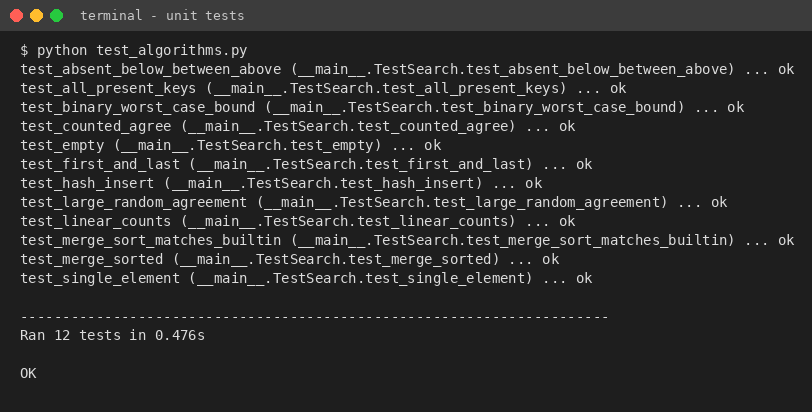

# Task 8 - Implementation and Testing (4 marks)

## Environment and files

All algorithms are implemented in **Python 3.12.3** (x86-64 Linux container, single thread). Timing uses time.perf_counter. The source code lives in Task_8_Implementation_Testing/Source_Code:

**Table 8.1 - Source files**

| File | Purpose |
|---|---|
| algorithms.py | linear_search, binary_search_recursive, merge_sort, merge_sorted, HashIndex (+ *_counted variants that return the number of comparisons) |
| data_gen.py | Reproducible dataset generator (seeded). 9-digit unique registration numbers, random storage order; present and absent query sets. |
| test_algorithms.py | 12 unit tests (edge cases, equivalence of all algorithms, theoretical operation counts). |
| run_experiments.py | Benchmark for n = 1,000 / 10,000 / 100,000 / 1,000,000; writes results.json / results.csv. |
| design_challenge.py | Task 12 experiments: 50,000 searches/hour, daily update strategies, break-even. |
| make_graphs.py / make_screenshots.py | Produce the figures and the rendered output/source images used in the report. |

## Testing procedure (reproducible)

- **Same data for all algorithms.** For each n the same seeded list of n unique registration numbers (random order) is given to Algorithm A; the same list, sorted by merge sort, is given to B; the same list is indexed by C. Because the seed is fixed, every run generates the same data.
- **Same queries.** 2,000 successful keys (randomly chosen existing numbers) and 2,000 unsuccessful keys (guaranteed absent). Linear search is much slower, so it uses the first 300 queries (100 when n >= 100,000) for timing; its comparison counts use 1,000 queries.
- **Timing.** Mean time per search = (total time of the query set) / (number of queries); the median of 3 (linear) or 5 (binary, hash) repetitions is reported. Preprocessing is timed separately (median of 3 repeats; once for n = 1M). Counting uses separate *_counted functions so that counters do not disturb timings.
- **Correctness.** Every algorithm's result is checked against the others and against the ground truth in unit tests; the sorted output of merge sort is asserted equal to Python's sorted().

**Table 8.2 - Test cases (all 12 unit tests pass)**

| Test case | Input | Expected result | Result |
|---|---|---|---|
| Empty database | [] , key 5 | -1 for all three | Pass |
| Single element - present / absent | [7], key 7 / 8 | 0 / -1 | Pass |
| Key is first / last record | 8-element list | found at the correct position | Pass |
| Key below minimum / between / above maximum | keys 1, 500, 5000 | -1 for all three | Pass |
| Every present key (small list) | 8 keys | found, record equals key | Pass |
| Merge sort correctness | n = 0,1,2,3,10,257,5000 | equals sorted() | Pass |
| Linear counts | n = 1000 | best 1, worst (last / absent) 1000 | Pass |
| Binary worst-case bound | n = 1,2,7,8,1000,4096 | max comparisons = floor(log2 n)+1 | Pass |
| Counted == plain versions | n = 1000, 200 queries | same positions | Pass |
| Large random agreement | n = 20,000; 500 hits + 500 misses | all three agree with ground truth | Pass |
| Hash insert (daily update) | insert 42 into [1,2,3] | found; length 4 | Pass |
| merge_sorted | two sorted lists | equals sorted(a+b) | Pass |



*Figure 8.1 - Unit-test output (python test_algorithms.py)*

The complete source code is included in the repository; rendered listings are in Report/Source_Code_Screenshots and in the appendix of this report.

## How to run

```text
cd Task_8_Implementation_Testing/Source_Code
python test_algorithms.py          # unit tests
python run_experiments.py          # Tasks 8-9 benchmark (about 2-3 minutes)
python design_challenge.py         # Task 12 experiments
python make_graphs.py              # figures (needs matplotlib)
```
